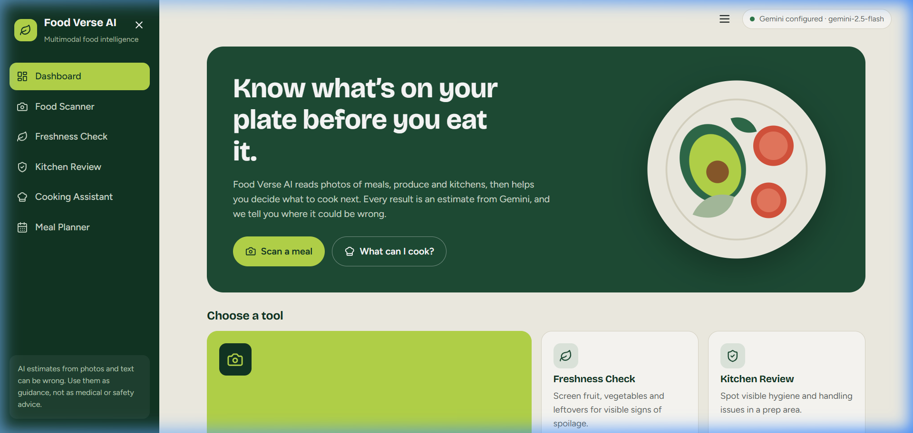
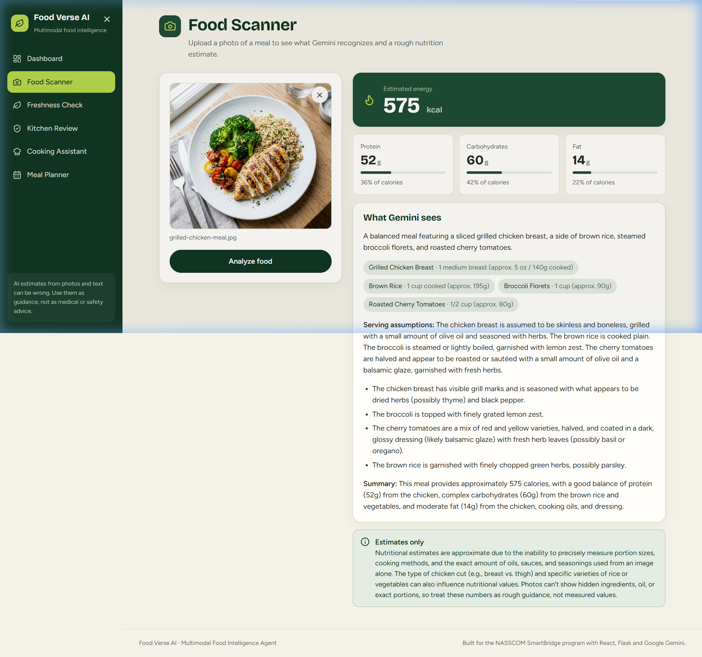
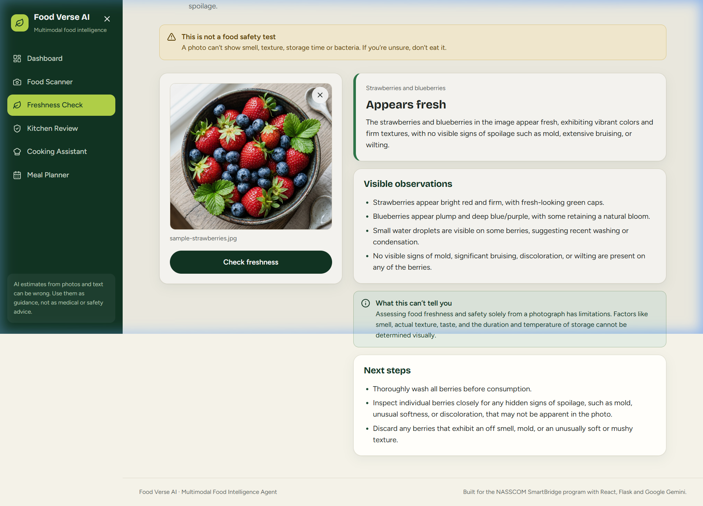
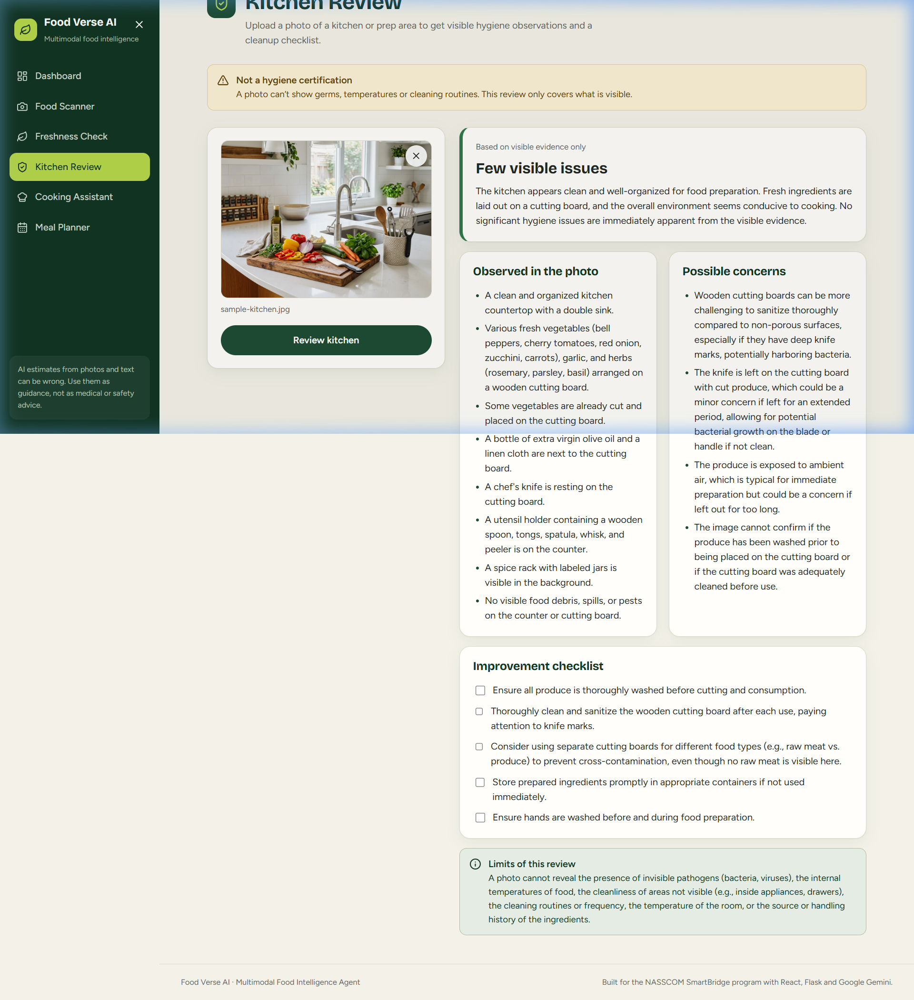
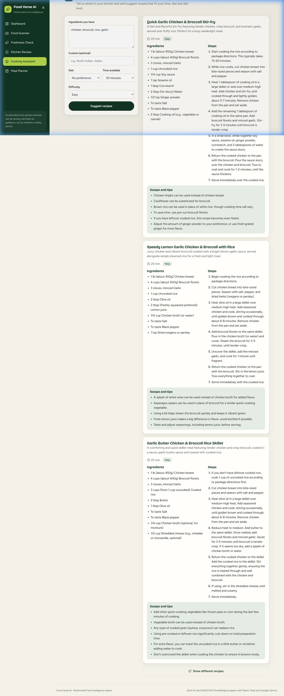
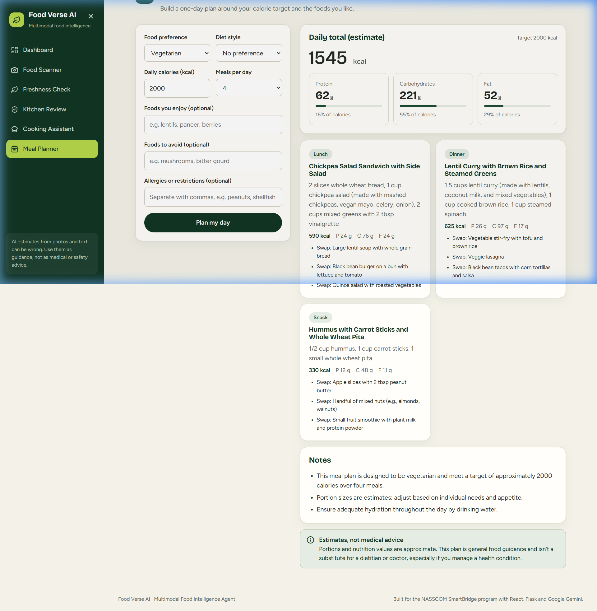
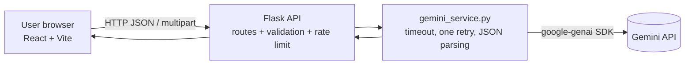

# Food Verse AI: Multimodal Food Intelligence Agent

NASSCOM SmartBridge project. A web app that uses Google Gemini to analyze food photos, screen produce freshness, review kitchen images, suggest recipes, and plan a day of meals.

## Problem statement
People often don't know roughly what is in a meal, whether produce is still good, how clean their prep area looks, or what to cook with what they have. Answers are scattered across calorie apps, search results and cookbooks.

## Proposed solution
One web app where the user uploads a photo or fills a short form and gets a structured, plainly worded AI result. Every result states its limits (estimates, visual-only screening) instead of presenting guesses as facts.

## Key features
| Feature | Page | Endpoint | Input |
|---|---|---|---|
| Food Scanner | `/scanner` | `POST /api/food/analyze` | image |
| Freshness Check | `/freshness` | `POST /api/food/freshness` | image |
| Kitchen Review | `/kitchen` | `POST /api/kitchen/analyze` | image |
| Cooking Assistant | `/cooking` | `POST /api/cooking/recipes` | JSON form |
| Meal Planner | `/planner` | `POST /api/meals/plan` | JSON form |
| Health | header status chip | `GET /api/health` | none |

## Screenshots of Working Application

### 1. Dashboard Overview


### 2. Food Scanner & Nutrition Estimation
*Live Gemini 2.5 Flash recognition: Grilled Chicken Breast, Brown Rice, Broccoli, Tomatoes (575 kcal, 52g protein)*


### 3. Freshness Checker & Spoilage Screening
*Live strawberry & blueberry freshness screening with visual observations & actionable next steps*


### 4. Kitchen Hygiene Review
*Cleanliness evaluation, surface risk assessment & sanitation checklist*


### 5. Cooking Assistant & Recipe Discovery
*Live generated bespoke recipes with ingredients, cook times, and instructions*


### 6. Personalized Meal Planner
*Daily calorie-aligned meal planning with macro distribution (1,545 kcal vegetarian plan)*


## Demonstration Video
A full-length, high-definition screen-recorded demo video is available in `submission_demo/`:
- **Full HD Demo (1080p, 1m 48s):** `submission_demo/Food_Verse_AI_NASSCOM_Demo.mp4`
- **Compact Demo (58s):** `submission_demo/Food_Verse_AI_Demo.mp4`
- **Evaluation Report:** `submission_demo/VERIFICATION_REPORT.md`

## Technology stack
React 18, Vite 5, React Router, lucide-react, CSS (frontend). Python, Flask, Flask-CORS, python-dotenv, `google-genai` SDK (backend). Google Gemini (default model `gemini-2.5-flash`, configurable).

## Architecture

- **Frontend:** UI, client-side file checks, loading/error states, rendering. It never holds the API key.
- **Backend:** validates every request, rate-limits POSTs, builds prompts, calls Gemini, validates the model's JSON, computes meal-plan totals itself, returns one JSON envelope.
- **Gemini integration:** one function (`generate_json`) sends the prompt (plus image for photo features) and requests `application/json`. Unusable output becomes an error; there is no mock or fallback data in the running app.
- **Privacy:** uploaded images are held in memory for the request only. Recent activity (titles only) is stored in the browser's localStorage.

## Prerequisites
Python 3.10+ and Node.js 18+ (npm 9+). A Gemini API key from https://aistudio.google.com/apikey. Versions above are the project's declared minimums; the sandbox used for development had Python 3.12 and Node 22.

## Installation and configuration (Windows PowerShell)
```powershell
# Backend
cd backend
python -m venv venv
.\venv\Scripts\Activate.ps1          # if blocked: Set-ExecutionPolicy -Scope Process Bypass
pip install -r requirements.txt
Copy-Item .env.example .env
notepad .env                          # set GEMINI_API_KEY=<your key>; save

# Frontend (second terminal)
cd frontend
npm install
```
macOS/Linux: `source venv/bin/activate` and `cp .env.example .env`.

`backend/.env` settings (see `.env.example`): `GEMINI_API_KEY`, `GEMINI_MODEL`, `GEMINI_TIMEOUT_SECONDS`, `CORS_ORIGINS`, `HOST`, `PORT`, `FLASK_DEBUG` (default 0), `RATE_LIMIT_PER_MINUTE` (default 10, 0 disables), `TRUSTED_PROXY_COUNT` (default 0). Optional `frontend/.env`: `VITE_API_BASE_URL` (default `http://localhost:5000`). Never put the key in a `VITE_` variable.

## Run
```powershell
# Terminal 1, from backend/ with venv active
python app.py                         # http://127.0.0.1:5000
# Terminal 2, from frontend/
npm run dev                           # http://localhost:5173
# Verify
Invoke-RestMethod http://127.0.0.1:5000/api/health
```
`/api/health` reports `gemini_configured`, `sdk_installed`, model and timeout. It never calls Gemini, so "ok" means the server is up and configured, not that the key is valid. Use `live_check.py` (below) for that.

## API reference
All responses: `{"success": true, "data": {...}, "model": "..."}` or `{"success": false, "error": {"code", "message", "field?"}}`.

| Endpoint | Request | Validation |
|---|---|---|
| `POST /api/food/analyze`, `/api/food/freshness`, `/api/kitchen/analyze` | multipart field `image` | JPG/PNG/WebP, detected from file contents, complete file, max 8 MB |
| `POST /api/cooking/recipes` | JSON `ingredients` (required, ≤800 chars), `cuisine` (≤60), `diet`, `max_time` (whole number 5–240, default 30), `difficulty` (Easy/Medium/Hard), `exclude` (list of recipe names) | unknown `diet`/`difficulty` rejected |
| `POST /api/meals/plan` | JSON `food_preference` (required: Vegetarian/Non-vegetarian), `diet`, `likes`, `dislikes`, `allergies` (list), `calorie_target` (required, whole number 1000–5000), `meals_per_day` (2–6, default 4) | decimals rejected, contradictory choices rejected, allergy listed as liked food rejected |

Error codes: `validation_error` 400, `file_too_large` 413, `rate_limited` 429 (ours or Gemini quota), `ai_not_configured` 503, `ai_blocked` 422, `ai_rejected` / `bad_response` / `empty_response` / `ai_unavailable` / `model_not_found` 502, `ai_timeout` 504, `server_error` 500.

## Testing
Fastest route: from the project root run `.\verify.ps1 -Live -Food meal.jpg -Freshness fruit.jpg -Kitchen kitchen.jpg`. It runs the backend tests, the live Gemini check, `npm install` and `npm run build`, and saves the output (no secrets) to `docs\test-evidence.txt`. Attach that file to your submission as test evidence.

Manual steps:
```powershell
cd backend
python -m unittest discover -s tests -v        # no key or network needed; Gemini is mocked
python live_check.py                           # real Gemini: config + one minimal call
python live_check.py --all --food meal.jpg --freshness fruit.jpg --kitchen kitchen.jpg
cd ..\frontend
npm run build                                  # production build
```
The unit tests prove validation, error handling and parsing. Only `live_check.py` proves the real Gemini path.

## Example usage
1. Open `/scanner`, drop a photo of a meal, select **Analyze food**: you get items, estimated kcal/protein/carbs/fat, serving assumptions and a caveat.
2. Open `/cooking`, enter `eggs, spinach, onion`, pick 30 minutes: you get three recipes; **Show different recipes** excludes the ones already shown.

## Known limitations
- Nutrition from a photo is an estimate; hidden oil, sauces and portion size are unknown.
- Freshness and kitchen results describe visible features only. They cannot prove food is safe or a kitchen is hygienic.
- Meal plans are general guidance, not medical or dietitian advice. Allergen mentions are flagged by simple text matching and can miss hidden allergens; always read labels.
- Rate limiting is in-memory and per process, so multiple workers each keep their own counts.
- Gemini output is non-deterministic; the same photo can give slightly different numbers.
- No frontend unit tests or browser end-to-end tests are configured.

## Security notes
`.env` is git-ignored; `.env.example` holds placeholders only. The key is read only by the backend and never logged or returned. Flask debug is off by default. CORS allows only listed origins on `/api/*`. `X-Forwarded-For` is ignored unless `TRUSTED_PROXY_COUNT` is set. Uploads are size-limited and checked by content. If a key was ever pasted into chat, a file or a commit, rotate it in Google AI Studio; deleting it from a file does not revoke it.

## Troubleshooting
| Symptom | Fix |
|---|---|
| Header says "Backend offline" | Start Flask; check `VITE_API_BASE_URL` and the port |
| "Gemini key missing" | Set `GEMINI_API_KEY` in `backend/.env`, restart Flask |
| "google-genai not installed" | Activate the venv, `pip install -r requirements.txt` |
| 502 `ai_rejected` / `model_not_found` | Key invalid, or set `GEMINI_MODEL` to a current vision model |
| 429 | Wait a minute (our limit or Gemini quota) |
| Browser CORS error | Add your frontend origin to `CORS_ORIGINS` |
| Port 5000 busy | Set `PORT=5001` and `VITE_API_BASE_URL=http://localhost:5001` |
| PowerShell won't activate venv | `Set-ExecutionPolicy -Scope Process Bypass` |

## Deployment note
Nothing is deployed. If you deploy later: set `FLASK_DEBUG=0`, serve the backend with a production server (for example `waitress-serve --port=5000 app:app` on Windows, `gunicorn app:app` on Linux; neither is in `requirements.txt`), build the frontend with `npm run build`, set `VITE_API_BASE_URL` before building, and set `CORS_ORIGINS` to the real site.

## Verification status
See `docs/VERIFICATION.md` for what was run, what was only simulated, and what is still untested.
